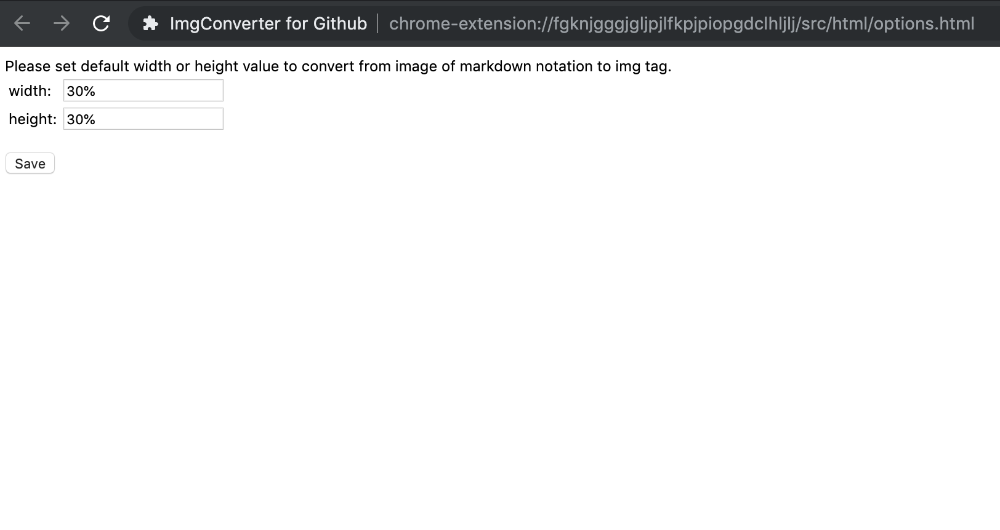

# ImgConverter

<p align="center">
    
</p>

<p align="center">
  <a href="https://github.com/funzin/ImgConverter/actions/workflows/test.yml">
    
  </a>
  <a href="https://developer.mozilla.org/en-US/docs/Web/JavaScript">
    
  </a>
  <a href="https://chrome.google.com/webstore/detail/imgconverter-for-github/pkgimcoeodgcdfnidhgijpopkfhbcomm">
    
  </a>
  <a href="https://addons.mozilla.org/en-US/firefox/addon/imgconverter/">
    
  </a>
  <a href="https://chrome.google.com/webstore/detail/imgconverter-for-github/pkgimcoeodgcdfnidhgijpopkfhbcomm">
    
  </a>
  <a href="https://codecov.io/gh/funzin/ImgConverter">
    
  </a>
</p>

## Overview

ImgConverter is a browser extension that converts Markdown image syntax into HTML `` tags when you click the toolbar icon. Focus a text field that contains ``, then click the icon. The extension can also apply a saved width and height so images resize consistently in GitHub issues, pull requests, and comments.

## Install

- [Chrome Web Store](https://chrome.google.com/webstore/detail/imgconverter-for-github/pkgimcoeodgcdfnidhgijpopkfhbcomm)
- [Firefox Add-ons](https://addons.mozilla.org/en-US/firefox/addon/imgconverter/)

## Supported formats

- PNG (`.png`)
- JPEG (`.jpg`, `.jpeg`)
- GIF (`.gif`)

## Tested with

- GitHub
- esa
- DocBase

The extension can run on other sites too. It converts `https:` image URLs in the focused text field.

## Use


1. Focus a text field that contains Markdown image syntax, for example on a GitHub issue, pull request, or comment.
2. Optionally select the Markdown image text you want to convert. If you select nothing, every match in the field is converted.
3. Click the ImgConverter toolbar icon.

The matching Markdown becomes an `` tag.

### Without a selection


Every Markdown image in the field is converted.

### With a selection


Only the selected text is converted.

## Set default size

You can set width and height values for converted `` tags on the options page. Enter only the value, such as `200px` or `50%`. Do not type `width=` or `height=` into the fields. If both fields are empty, conversion uses `width=50%`.

1. Right-click the ImgConverter icon and click **Options** (Chrome). On Firefox, open the add-on preferences from `about:addons`.


2. Enter width and height values, then click **Save**.



### Examples

#### Both fields empty

```
// before


// after (built-in fallback)

```

#### Width only

Enter `200px` in the width field.

```
// before


// after

```

#### Height only

Enter `200px` in the height field.

```
// before


// after

```

#### Width and height

Enter `200px` in both fields.

```
// before


// after

```

## Develop

- JavaScript
- Node.js 12.x, 14.x, or 16.x (CI)
- npm
- Karma with Jasmine

```bash
npm test
npm run debug_test
```

## Contact

If you find a problem or have feedback, open a [GitHub issue](https://github.com/funzin/ImgConverter/issues).

## Author

funzin, nakazawa.fumito@gmail.com

## License

ImgConverter is available under the MIT license. See the [LICENSE file](https://github.com/funzin/ImgConverter/blob/master/LICENSE.md) for more info.
