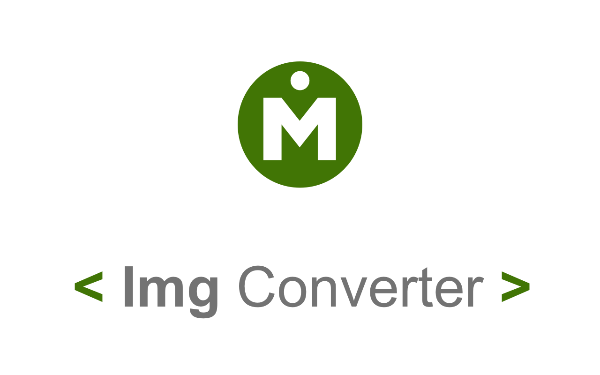
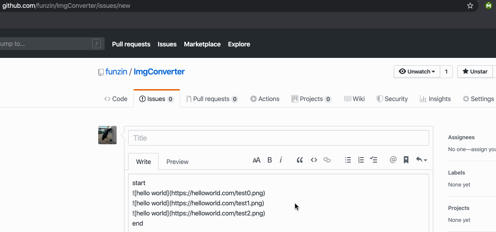
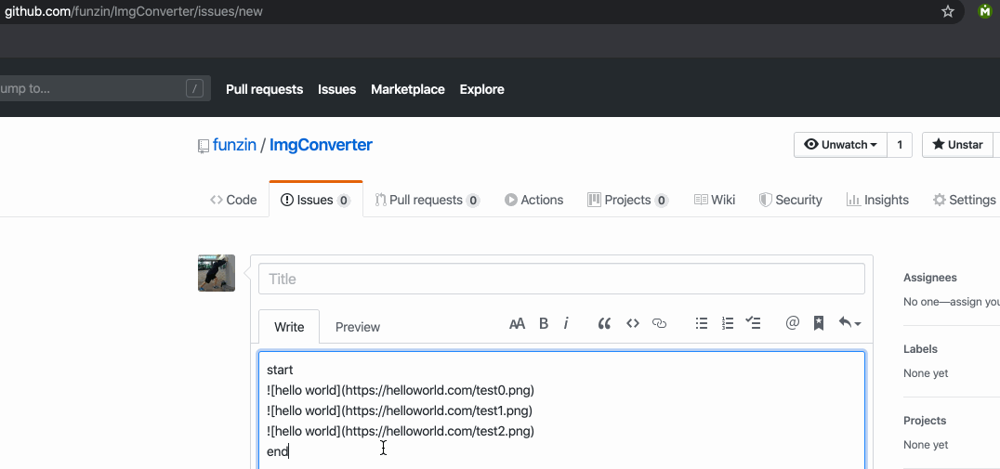
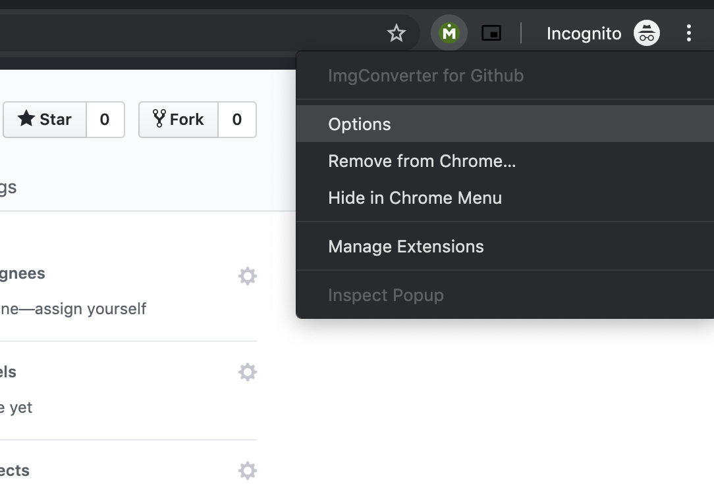

# ImgConverter

<p align="center">
    
</p>

<p align="center">
  <a href="https://github.com/funzin/ImgConverter/actions/workflows/test.yml">
    
  </a>
  <a href="https://chrome.google.com/webstore/detail/imgconverter-for-github/pkgimcoeodgcdfnidhgijpopkfhbcomm">
    
  </a>
  <a href="https://addons.mozilla.org/en-US/firefox/addon/imgconverter/">
    
  </a>
  <a href="https://codecov.io/gh/funzin/ImgConverter">
    
  </a>
</p>

ImgConverter is a Chrome and Firefox extension that converts Markdown images to HTML `` tags with one click. Markdown image syntax has no way to set the image size, but an `` tag has `width` and `height` attributes. ImgConverter adds the width and height you save on the options page, or `width=50%` if you save neither.

## Convert Markdown images

1. Install ImgConverter from the [Chrome Web Store](https://chrome.google.com/webstore/detail/imgconverter-for-github/pkgimcoeodgcdfnidhgijpopkfhbcomm) or [Firefox Add-ons](https://addons.mozilla.org/en-US/firefox/addon/imgconverter/).
2. Click in a text field that contains a Markdown image, such as ``.
3. Click the ImgConverter icon in the browser toolbar. If you do not see the icon, open the Extensions menu from the puzzle icon.

ImgConverter replaces each Markdown image in the field with an `` tag.



To convert only some images, select their full Markdown text before you click the icon. ImgConverter leaves the rest of the field unchanged.



## Set the width and height

1. Right-click the ImgConverter icon and click **Options**. In Firefox, open the ImgConverter options from `about:addons` instead.



2. Enter a value in the **width** field, the **height** field, or both. Enter only the value, such as `200px` or `50%`.
3. Click **Save**.

ImgConverter uses the saved values for each new `` tag. To return to `width=50%`, clear both fields and click **Save**.

## Conversion rules

ImgConverter converts a Markdown image only when its URL starts with `https:`. It copies the URL into the `` tag and drops the alt text.

The size attributes depend on the saved width and height. Each row shows what `` becomes.

| Saved width | Saved height | Result |
| --- | --- | --- |
| Empty | Empty | `` |
| `200px` | Empty | `` |
| Empty | `200px` | `` |
| `200px` | `200px` | `` |

## Tested formats and sites

ImgConverter does not check the file type. These image formats are tested:

- PNG
- JPEG
- GIF

ImgConverter is not limited to specific sites. These sites are tested:

- GitHub
- esa
- DocBase

## Develop

- JavaScript
- Node.js 22.x or 24.x (CI)
- npm
- Karma with Jasmine

```bash
npm test
npm run debug_test
```

## Report a problem

To report a bug or suggest a change, open an issue in [GitHub Issues](https://github.com/funzin/ImgConverter/issues).

## Author

funzin, nakazawa.fumito@gmail.com

## License

ImgConverter is available under the MIT license. See the [LICENSE file](https://github.com/funzin/ImgConverter/blob/master/LICENSE.md).
