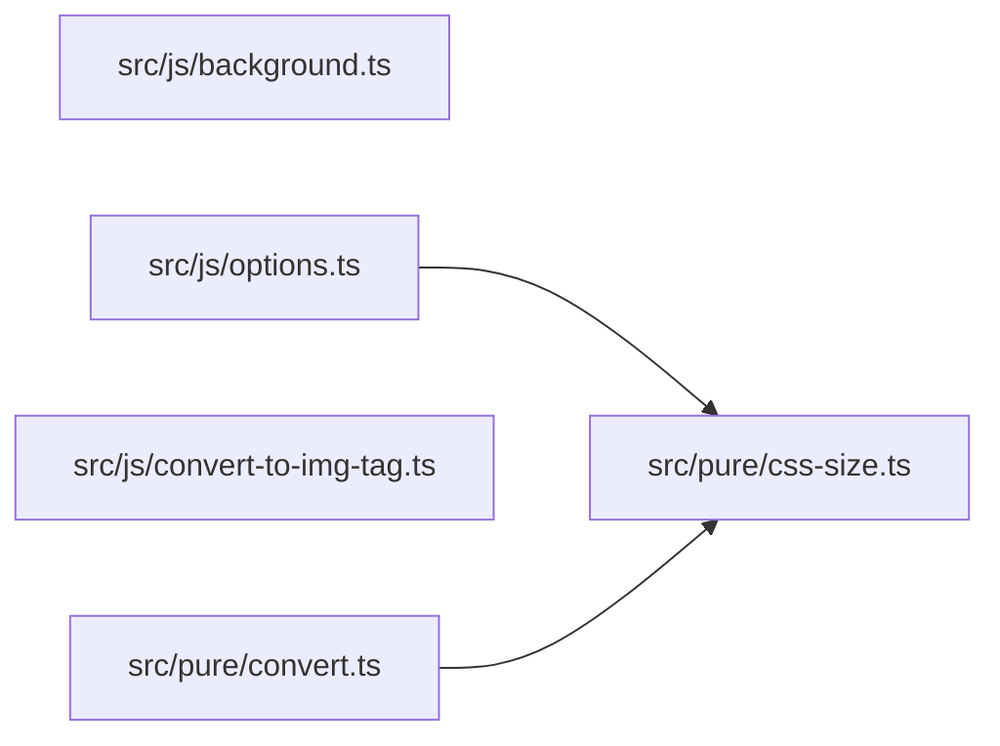

# 拡張機能のモジュール構造

この文書は、ImgConverter 0.7.0 の3つの TypeScript を、あとからモジュールへ分けるための設計である。読む人は、この拡張を直す開発者である。この PR は文書だけを足す。ツールバーのクリックで行う変換と、オプションページの保存は、今と同じ動作のままにする。

推奨は esbuild で3つのクラシック IIFE を出すことである。サイズの文法と2つの方針は `src/pure/css-size.ts` に置く。画像への書き換えは `src/pure/convert.ts` に置く。chrome、DOM、`statusTimer` は今の3つのエントリに残す。クラスは置かない。移行は4つの PR に分ける。

## 今の構造

プログラムは `src/js/background.ts`、`src/js/options.ts`、`src/js/convert-to-img-tag.ts` だけである。`tsc` は import も export も無いこれらのファイルを、隣のクラシック `.js` へ出す。3ファイルは互いに import しない。実行時に共有するのは `chrome.storage.sync` の文字列と、型だけの `CssSize` である。

### background.ts

`src/js/background.ts:1-9` は `chrome.action.onClicked.addListener` の呼び出し1つである。トップレベルの `var`、`let`、`const`、`function`、`class` は無い。`tab.id` が `undefined` のときは `src/js/background.ts:2-4` で戻る。あるときは `src/js/background.ts:5-8` が `chrome.scripting.executeScript` を呼び、`files` は `["src/js/convert-to-img-tag.js"]` だけである。`world`、`allFrames`、`func`、`args` は指定しない。

このファイルは storage も DOM も読まない。状態は持たない。リスナーは、サービスワーカーの最初の評価で同期に登録する必要がある。同じ領域でもう一度評価すると、リスナーが2つになる。Chrome がワーカーを起動し直すときは、新しいグローバルで1回だけ登録する。

`manifest.json:13-16` は同じ `src/js/background.js` を `background.service_worker` と `background.scripts` の両方に書く。`background.type` は無い。Chrome はサービスワーカーとして起動する。Firefox 158 は `service_worker` だけのマニフェストを拒否し、エラー文は `background.scripts` を足すよう言う。これは [PR #112](https://github.com/funzin/ImgConverter/pull/112) の記録である。`manifest.json:7` の `minimum_chrome_version` は `"121"` で、`background.scripts` を無視する最初の Chrome として同 PR が説明している。`spec/js/manifest.test.js:7-11` がこの3つを固定する。権限は `activeTab`、`storage`、`scripting` である（`manifest.json:8-12`）。`content_scripts` も `web_accessible_resources` も無い。拡張ページの CSP は `script-src 'self'` である（`manifest.json:40-42`）。

### convert-to-img-tag.ts

このファイルはクリックのたびに、同じコンテンツスクリプトの領域でもう一度評価される。トップレベルの束縛は関数宣言だけである。`let` と `const` はコールバックと関数の中にある。

副作用は先頭にある。`src/js/convert-to-img-tag.ts:1-23` が `chrome.storage.sync.get` を呼び、`document.activeElement` を読み、結果が null でなければ `document.execCommand("insertText", false, replacedText)` を実行する。`src/js/convert-to-img-tag.ts:17-21` のコメントが理由を書いている。`value` への代入は React の入力ハンドラを通らないので、プレビューで Markdown に戻る。`insertText` は元に戻せる編集である。これは [PR #111](https://github.com/funzin/ImgConverter/pull/111) の変更である。`callOn`（`src/js/convert-to-img-tag.ts:43-49`）は要素の `focus` と `select` を呼ぶ。

選択範囲は `src/js/convert-to-img-tag.ts:10-13` で決める。`selectionStart` と `selectionEnd` があり、`start !== end` のときは `convertOnlySelectionToImgTag`（`src/js/convert-to-img-tag.ts:54-61`）が部分文字列を変換して元の文字列へ戻す。範囲が無いときと、範囲の幅が 0 のときは全体を `convertToImgTag` する。書き込みは制御全体を選択してから `insertText` するので、選択の結果も制御全体の置換になる。

引数だけで結果が決まる関数は次である。`controlValue`（`src/js/convert-to-img-tag.ts:25-29`）、`isSelectionEdge`、`selectionBounds`（`src/js/convert-to-img-tag.ts:35-41`）、`convertOnlySelectionToImgTag`、`convertToImgTag`（`src/js/convert-to-img-tag.ts:63-74`）、`isParsedSize`、`parseSize`（`src/js/convert-to-img-tag.ts:76-88`）、`escapeAttr`、`decodeAttr`、`asSize`、`imageTag`（`src/js/convert-to-img-tag.ts:114-122`）、`namedGroup`、`createMarkdownImages`（`src/js/convert-to-img-tag.ts:132-162`）、`createParams`（`src/js/convert-to-img-tag.ts:164-175`）。`createParams` は渡されたオブジェクトを読むだけで、`chrome.storage` は呼ばない。

`convertToImgTag` は `https:` の Markdown 画像と、GitHub の user-attachments の `` だけを置換する。パターンは `src/js/convert-to-img-tag.ts:144` と `src/js/convert-to-img-tag.ts:152` にある。置換は関数を渡すので、URL 中の `$&` と `$$` はそのまま残る（`src/js/convert-to-img-tag.ts:69-71`）。幅と高さは `CssSize` をそのまま属性へつなぐ。エスケープしない（`src/js/convert-to-img-tag.ts:119-120`）。文法の正規表現が属性注入の境界である。

### options.ts

`src/html/options.html:25` が `../js/options.js` を `defer` で1つ読む。`spec/js/options.test.js:184-192` がその個数、`src`、`defer`、空の本文を固定する。文書はファイルを1回だけ評価する。

`src/js/options.ts:1` が `loadStorage()` を呼ぶ。`loadStorage`（`src/js/options.ts:5-9`）は `chrome.storage.sync.get` の結果を `setText` へ渡す。`setText`（`src/js/options.ts:30-41`）は `#width` と `#height` へ、受理できたサイズだけを書く。`src/js/options.ts:60-66` が `#size-form` の submit を受け、`saveSize`（`src/js/options.ts:86-123`）が入力を判定して `chrome.storage.sync.set` する。

長生きするミュータブルな束縛は `let statusTimer` だけである（`src/js/options.ts:43`）。`showStatus`（`src/js/options.ts:45-58`）がそれを消し、`#status` を書き、必要なら 2000ms 後に空文字へ戻すタイマーを入れる。拒否のメッセージはタイマーを持たない。成功時だけ `showStatus("Saved", 2000)` になる（`src/js/options.ts:122`）。

空欄は `""` として保存する（`storedSize`、`src/js/options.ts:25-28`）。解釈できない値は保存しない（`src/js/options.ts:101-111`）。前の保存が残る。これは [PR #122](https://github.com/funzin/ImgConverter/pull/122) の方針である。

### 型とテストが依存しているもの

`src/types/css-size.d.ts:1` は `type CssSize = string & { readonly __brand: "CssSize" }` である。import も export も無く、実行ファイルは出ない。`tsconfig.json:12` がこの宣言をプログラムに含める。

`tsconfig.json:4-6` は `"module": "ES2022"` と `"moduleDetection": "auto"` である。import も export も無いファイルはスクリプトのままになる。値の import を書くと、出力に `import` が出る。`import type` だけでも、TypeScript 6.0.3 はこの設定で末尾に `export {}` を出す。クラシックなローダはその1行で構文エラーになる。`eslint.config.mjs:31-36` は `src/**/*.ts` を `sourceType: 'script'` として読む。

Node のテストは `spec/helpers/browser.js:41-45` の `vm.runInThisContext` で、コンパイル後の `.js` を今の領域で実行する。`loadConverter`（`spec/helpers/browser.js:47-73`）は `convert-to-img-tag.js` を同じ領域で3回評価する。Playwright の `spec/browser/reinjection.spec.js` は `page.addScriptTag` で2回注入し、`pageerror` が無いことを見る。2回目の評価でプログラム本体の `class`、`let`、`const` は `SyntaxError: Identifier has already been declared` になる。関数宣言は置き換わる。この制約は [PR #89](https://github.com/funzin/ImgConverter/pull/89) の Blast Radius と、2021年の [issue #36](https://github.com/funzin/ImgConverter/issues/36)（`MarkdownImage` の再宣言）から来ている。クラスの削除は #89（2026年）である。#36 を閉じた [PR #37](https://github.com/funzin/ImgConverter/pull/37) の本文は正規表現の修正を書いており、クラスは残っていた。

テストが名前で呼ぶグローバルは6つである。`convertToImgTag`、`convertOnlySelectionToImgTag`、`createParams`、`createMarkdownImages`、`loadStorage`、`setText`。ESLint が `eslint.config.mjs:48-53` に書く。`spec/js/options.test.js:16` は `spyOn(self, "setText")` し、次の `loadStorage()` がそのスパイを通ることを期待する。`saveSize`、`showStatus`、`parseSize`、`imageTag` をテストは名前で呼ばない。

`npm test` は先に `tsc` し、`node --test` で `spec/js/*.test.js` を走らせ、その後 Playwright を走らせる（`package.json:19`）。カバレッジの対象は `convert-to-img-tag.js` と `options.js` だけである。`background.js` は含まれない。Node の `it` は 49 + 17 + 1 で 67、Playwright の `test` は 3 である。

### 痛点

サイズの受理判定が2箇所にある。オプションは `isAcceptedSize` と `acceptedSize`（`src/js/options.ts:11-23`）。変換は `isParsedSize` と `parseSize`（`src/js/convert-to-img-tag.ts:76-88`）。中身は同じで、空白を除き、単位の大小を無視して照合し、`px` と `%` を小文字にする。まわりの方針は違う。オプションの空欄は `""` で、不正な欄は保存全体を止める。変換の `createParams` は両方が使えないときだけ幅を `"50%"` にする。片方が使えるときはその片方だけを残す。`""` を `convertToImgTag` へ渡すと属性を出さない。これは本番のクリックは通らない経路で、`spec/js/convert-to-img-tag.test.js:317-320` が固定している。50% は `createParams` の結果を渡したときだけ出る。

純粋な書き換えを、chrome も DOM も storage も無しで単体テストできない。変換ファイルの評価が `chrome.storage.sync.get` から始まる。テストはそのファイル全体を実行してからグローバルを呼ぶ。

関数はファイルの直下に並ぶ。テストが使う名前と、使わないヘルパが同じ置き場所にある。次に編集する人が、公開するつもりの無い関数をグローバルとして呼ぶ。

[PR #125](https://github.com/funzin/ImgConverter/pull/125) の Tradeoffs は、オプションと注入スクリプトがそれぞれサイズを解釈すること、モジュールを共有できないこと、`executeScript` と Firefox の `background.scripts` がクラシックスクリプトを読むこと、tsc が import 無しのスクリプトを出すこと、バンドラは不要であることを書いている。この文は PR 本文にだけある。同じ変更のコミット `b27e036` と `README.md:78` は、クラシックなスクリプトを出すことと `CssSize` だけを繰り返す。共有できないことと、バンドラが不要であることは、TypeScript 化のときに受け入れた判断であり、ADR では無い。ローダがクラシックスクリプトであることは、その判断の前提として残す。

## 提案する構造

### 呼び出し

オプションとクリックは、chrome のオブジェクトも DOM ノードも共有しない。共有するのは保存された文字列である。オプションは2つの欄を保存してよいかを決める。クリックはその文字列を読み、フォーカス中の制御を書き換える。空の組を保存することは成功である。クリックはその組を `width="50%"` にする。

オプションの保存は、欄の文字列を読んだあとでこう呼ぶ。

```typescript
const decision = decideSave(width.value, height.value)
if (decision.save) {
  chrome.storage.sync.set({ width: decision.width, height: decision.height })
}
```

クリックは、制御の文字列と選択範囲を読んだあとでこう呼ぶ。

```typescript
const next = convertEditorText(text, storage, bounds)
if (next != null) {
  document.execCommand("insertText", false, next)
}
```

chrome も DOM も無いテストは、保存の結果を変換へ渡す。

```typescript
const saved = decideSave("  ", "")
// { save: true, width: "", height: "" }

const next = convertEditorText(
  "",
  { width: "", height: "" },
  null,
)
// 
```

`decideSave` は 50% を決めない。`convertEditorText` は storage を受け取り、`""` という「属性を出さない」入力は受け取らない。その入力は、今のテストが呼ぶ `convertToImgTag(text, "")` に残す。本番のクリックはその関数を直接呼ばない。

### モジュール



`src/pure/css-size.ts` が文法と2つの方針を持つ。import は無い。chrome も DOM も、モジュール先頭の `let` も無い。外へ出すのは `canonicalSize`、`decideSave`、`createParams` と、下の型である。

`src/pure/convert.ts` が Markdown と GitHub の照合、属性のエスケープ、選択範囲の接合を持つ。`css-size.ts` から `createParams` と型を import する。外へ出すのは `convertEditorText` と `classicGlobals` だけである。

`src/js/options.ts` は `canonicalSize` と `decideSave` だけを import する。フォーム、`chrome.storage.sync`、ラベルとヒントの文、`statusTimer` を持つ。`loadStorage` と `setText` を `globalThis` へ出す。

`src/js/convert-to-img-tag.ts` は `convertEditorText` と `classicGlobals` だけを import する。`chrome.storage.sync.get`、フォーカス中の制御、`insertText` を持つ。評価の最初に `classicGlobals` を `globalThis` へコピーし、そのあと storage を読む。

`src/js/background.ts` は pure を import しない。今のリスナーのまま、注入するファイルは1つのままである。

`css-size.ts` は `convert.ts` を import しない。`options.ts` は `convert.ts` を import しない。`convert-to-img-tag.ts` は `css-size.ts` を import しない。ESLint の `no-restricted-imports` でこの3つを禁じる。`src/pure/index.ts` は作らない。バレルは2つ目の import 経路になる。

`src/pure/` は `scripts/package.mjs:13-18` の zip 対象の外である。pure の `.ts` を `src/js/` の隣に置くと、次の編集がエントリの横にもう1つスクリプトを足しやすくなる。ディレクトリが境界である。

### 型とシグネチャ

`CssSize` は ambient 宣言から `css-size.ts` の export へ移す。ブランドは型だけである。実行時の検査は1つの正規表現だけである。`src/types/css-size.d.ts` は、その型を export する PR で削除する。シェルが import 無しで `CssSize` を名指しできないようにする。

```typescript
export type CssSize = string & { readonly __brand: "CssSize" }

export type StorageRecord = { readonly [key: string]: unknown }

export type SizeParams = {
  readonly width: CssSize | null
  readonly height: CssSize | null
}

export type AppliedSize =
  | { readonly width: CssSize; readonly height: CssSize | null }
  | { readonly width: null; readonly height: CssSize }

export type FieldName = "width" | "height"

export type SaveDecision =
  | {
      readonly save: true
      readonly width: "" | CssSize
      readonly height: "" | CssSize
    }
  | {
      readonly save: false
      readonly invalid: readonly [FieldName, ...FieldName[]]
    }

export function canonicalSize(raw: unknown): CssSize | ""

export function decideSave(widthText: string, heightText: string): SaveDecision

export function createParams(storage: StorageRecord): AppliedSize
```

`parseCssSize` は export しない。`canonicalSize`、`storedSize`、`createParams` だけが呼ぶ。空文字、欠落、不正は null になる。正規形は trim 済みで、単位は小文字である。`storedSize` も export しない。空白だけの欄は、`parseCssSize` より前に `""` と判定する。`parseCssSize("")` は null であり、空欄の保存とは別である。

`SaveDecision` の失敗側は幅も高さも持たない。シェルは片側だけを保存するために値を作ることはできない。`invalid` は1つ以上の欄名を持ち、幅が高さより前に並ぶ。フォーカスは `invalid[0]` である。

`createParams` の戻り値は `AppliedSize` である。少なくとも片方は `CssSize` である。両方 null という状態は型に無い。TypeScript 6.0.3 では `width == null && height == null` の1つの条件がもう片方を絞らないので、実装はネストした `if` で絞る。`"50%"` の解釈に失敗したときは `throw new Error("50% is a valid size")` のままである。これはユーザーの入力では起きない。`SizeParams` は `imageTag` と、属性を出さない `""` 経路のために残す。`createParams` は `""` を返さない。

```typescript
export type TextRange = {
  readonly start: number | null
  readonly end: number | null
}

export type ConvertParams = SizeParams | "" | null | undefined

export type RenderedImage = {
  url: string
  mdImageText: string
  imageTag: string
}

export function convertEditorText(
  text: string,
  storage: StorageRecord,
  bounds: TextRange | null,
): string | null

export const classicGlobals: {
  readonly convertToImgTag: (text: string, params: ConvertParams) => string | null
  readonly convertOnlySelectionToImgTag: (
    text: string,
    params: ConvertParams,
    start: number | null,
    end: number | null,
  ) => string | null
  readonly createParams: (storage: StorageRecord) => AppliedSize
  readonly createMarkdownImages: (
    text: string,
    params: ConvertParams,
  ) => RenderedImage[] | null
}
```

`convertEditorText` がクリックの入口である。`bounds` が null のときと、`start === end` のときは全体を変換する。`start !== end` のときはその範囲だけを変換して接合する。storage の解釈はこの関数の中で行う。呼び出し側は `ConvertParams` を渡さない。

`RenderedImage` は3つのフィールドを持つレコードである。クラスにはしない。`spec/js/convert-to-img-tag.test.js` が `url`、`mdImageText`、`imageTag` を読む。同じ URL が2回あれば、どちらも変換する。並びは出現順であり、URL をキーにした辞書にはしない。

`classicGlobals` はクリックの入口では無い。`loadConverter` のあとでテストが呼ぶ4つの名前を、出荷する1ファイルのグローバルへ残すためのオブジェクトである。クリックのエントリはそれを `globalThis` へ代入し、編集そのものは `convertEditorText` で行う。次の評価は代入で上書きする。`let` や `const` の再宣言にはならない。

エントリに残す関数は export しない。

```typescript
function controlValue(el: Element): string | undefined
function selectionBounds(el: Element): TextRange | null
function callOn(el: Element, name: string): void

let statusTimer: ReturnType<typeof setTimeout> | null
function showStatus(text: string, clearAfterMs?: number): void
function requireInput(id: string): HTMLInputElement
function labelName(field: HTMLInputElement): string
function saveSize(): void
```

`requireInput`、`labelName`、ヒントの取得が投げる `TypeError` の文は、今の `src/js/options.ts:50`、`src/js/options.ts:71`、`src/js/options.ts:77`、`src/js/options.ts:81` のままにする。テストは投げないが、欠落した DOM の失敗の形は変えない。

`loadStorage` は `globalThis.setText` を呼ぶ。`spec/js/options.test.js:16` のスパイは `self.setText` を差し替える。`spec/helpers/browser.js` は `self` を今のグローバルへ向けているので、この代入をスパイが観測する。公開は、起動時の `loadStorage()` より前に行う。テストの storage モックはコールバックを同期で呼ぶ。

### クラスを置く場所と、関数のままにする場所

クラスが場所を得るのは、同一性か、関数から見えないミュータブルな不変条件を持つときである。このプログラムでその候補になるのは `statusTimer` だけである。

検討した形は、オプションの IIFE の中の `StatusLine` で、フィールドは `#timer` だけ、というものである。`show` は毎回 `getElementById("status")` する。コンストラクタで要素を持つと、テストが `document.body.innerHTML` を差し替えたあとで、切り離されたノードを更新する。

このクラスは置かない。オプションの文書はスクリプトを1回だけ評価する。IIFE の中の `let statusTimer` は、プログラム本体の再宣言にならない。書き手は `showStatus` だけである。クラスにすると、同じクリアとセットを `this` 経由で読むことになる。タイマーの置き場所は隠れるが、保存の方針も DOM の手順も隠れない。背景の `BackgroundController` と、データのだけの `MarkdownImage` も置かない。後者は [PR #89](https://github.com/funzin/ImgConverter/pull/89) が削った形である。issue #36 の再宣言は、プログラム本体の `class` だった。IIFE の中なら再宣言は避けられる。それでもデータを包むだけのクラスは、テストが読む3つのフィールドをコンストラクタに通すだけになる。

変換、文法、エスケープ、選択の接合は関数にする。方針は `decideSave` と `createParams` の2つの関数にする。モード引数の1関数にはしない。呼び出し側が `"store"` と `"convert"` を選び、間違ったモードも型を通るからである。

`background.ts` は今の無名関数のままにする。隠す方針が無い。

### 純粋な部分と境界

`parseCssSize` が storage と入力欄の境界である。そこから先の `CssSize` は信頼する。`imageTag` は幅と高さをエスケープしない。2つ目の検査は2つ目の方針になる。

`decideSave` と `convertEditorText` がシェルから見た境界である。オプションのシェルがまだ自分で行うのは、chrome への書き込み、`aria-invalid`、最初の不正欄へのフォーカス、ラベルとヒントを連結した文、タイマーである。クリックのシェルがまだ自分で行うのは、storage の取得、フォーカス中の要素の読み取り、`focus`、`select`、`insertText` である。

クリックを追う人は `convert-to-img-tag.ts`、`convert.ts`、`css-size.ts` を開く。オプションを追う人は `options.ts` と `css-size.ts` を開く。`background.ts` はその連鎖に入らない。

## ビルドへの影響

出荷するファイルは、今と同じ3つのクラシックスクリプトでなければならない。`vm.runInThisContext`、オプションの `<script src>`、Playwright の `addScriptTag`、`background.type` の無い Chrome のサービスワーカー、Firefox の `background.scripts`、`executeScript` の `files` は、どれも `import` と `export` を拒否する。zip の検査は構文を見ない。`src/js/` の下の ESM は `npm run package` を通り、ローダで落ちる。

### 案A. tsc のまま、import を書かない

`moduleDetection: "auto"` のまま、import も export も書かなければ、今どおりクラシックなスクリプトが出る。新しい依存は増えない。`README.md:78` の説明もそのままである。

この案で文法を1つにする方法は、各エントリにコピーを残すか、もう1つのスクリプトをページに読ませることである。コピーは `src/js/options.ts:11-23` と `src/js/convert-to-img-tag.ts:76-88` の手同期を残す。2つ目の script タグは `spec/js/options.test.js:188` が拒否する。2つ目の background パスは `spec/js/manifest.test.js:9-10` が拒否する。`executeScript` の2つ目のファイルは `src/js/background.ts:7` のリストを広げる。

`tsc --outFile` も使わない。TypeScript 6.0.3 は、`module: ES2022` のとき `outFile` を非推奨とし、AMD と System 以外では拒否する。AMD の `define` と System の登録は、`vm.runInThisContext` も `<script src>` もそのままでは実行しない。namespace の出力は `var` と1つのオブジェクトになり、テストが呼ぶ裸の `convertToImgTag` にはならない。ファイルを連結する短いスクリプトは、道具が tsc でなくてもバンドラである。読むファイルと出荷するファイルが分かれる。

この案では、chrome の呼び出しを含まないファイルを Node が import できない。純粋な関数は、評価すると `chrome.storage.sync.get` が走るファイルの中に残る。

### 案B. esbuild でエントリごとに IIFE へ束ねる

ソースは `import` を使う。esbuild が各エントリを1つのクラシック IIFE にし、`src/js/background.js`、`src/js/options.js`、`src/js/convert-to-img-tag.js` へ書く。`format` は `iife`、`target` は `es2022`、`platform` は `browser`、`splitting` は false、minify も sourcemap も無し、先頭は `"use strict";` である。

`tsc` は `noEmit` にする。`npm run typecheck` は2つのプロジェクトを見る。エントリ側は今の `lib` と `types: ["chrome"]` のまま、import をたどって pure を型検査する。`tsconfig.pure.json` は `src/pure/**/*.ts` を `lib: ["ES2022"]`、`types: []`、`moduleResolution: "bundler"`、`verbatimModuleSyntax`、`isolatedModules`、`noEmit` で見る。エントリ側の DOM の lib は、pure に紛れ込んだ `document` を見逃す。pure 側のプロジェクトがそれを落とす。

`scripts/bundle.mjs` がビルドしたあと、TypeScript のパーサで各出力を見る。プログラム本体は、任意の `"use strict"` と、アロー関数の IIFE の呼び出し1つだけを許す。トップレベルの `import`、`export`、`class`、`let`、`const`、`var`、`function` は失敗にする。`src/js/` にこの3つ以外の `.js` があれば失敗にする。`options.js` に `user-attachments` か `50%` があれば失敗にする。`convert-to-img-tag.js` に `Nothing was saved` か `statusTimer` があれば失敗にする。`options.js` に `globalThis.setText` と `Nothing was saved` が無ければ失敗にする。`convert-to-img-tag.js` に `insertText` と `user-attachments` が無ければ失敗にする。同じ領域で `convert-to-img-tag.js` を2回評価して例外になるか、`convertToImgTag` が関数で無ければ失敗にする。

IIFE の内側の `const` と `let` は、評価のたびに新しい関数スコープになる。2回目の注入は再宣言しない。`spec/browser/reinjection.spec.js` と `loadConverter` がこれを観測する。esbuild はモジュール先頭の `const` を、その関数の中の `var` として出すことがある。`undefined` を `void 0` に、`2000` を `2e3` に出すことがある。値は同じである。`mock.timers.tick(2000)` は同じ遅延で発火する。古い `tsc` の出力とバイト単位で揃えることはしない。

純粋なテストは、同じスクリプトが `spec/pure/*.test.ts` を CommonJS へ束ねる。`node:test` と `node:assert/strict` は external にする。出力は gitignore する `spec/pure/.out/` で、zip の対象外である。`package.json` に `"type": "module"` は足さない。今のテストは `require` のままである。Node 22 と Node 24 の型除去フラグの差には依存しない。

### 推奨

案Bを採る。ソースの import はローダへ届かない。出荷は今の3パスのクラシックスクリプトである。文法のソースは1つになり、zip の中では `options.js` と `convert-to-img-tag.js` の両方にインライン展開される。その重複は生成物であり、直す場所は1ファイルである。案Aはローダの制約を満たしたまま、純粋な関数を chrome 無しで import できない。

[PR #125](https://github.com/funzin/ImgConverter/pull/125) の「バンドラは不要」は、import 無しの tsc 出力で移行を終えたときの判断である。この推奨はその文を更新し、その文が守っていたローダの制約は残す。

### zip とマニフェスト

マニフェストは変えない。`background.service_worker` と `background.scripts` は `src/js/background.js` のまま、`minimum_chrome_version` は `"121"` のまま、`background.type` は足さない。オプションページの script タグは1つのままである。`executeScript` の `files` も1つのままである。

`npm run package` が今書く `dist/ImgConverter-0.7.0.zip` は 15 エントリである。`manifest.json`、`src/`、`src/html/`、`src/html/options.html`、`src/js/`、3つの `.js`、`resource/`、`resource/image/`、`resource/image/icons/`、`16.png`、`48.png`、`128.png`、`source.png` である。案Bのあともこの15のままである。`src/pure/*.ts` は対象外である。`.ts` と `.map` は `scripts/package.mjs:86-88` が落とす。sourcemap は出さない。カバレッジは今どおり束ねた2つの `.js` を見る（`package.json:19`）。行番号は TypeScript の行とは揃わない。

変わるバイトは次のとおりである。`background.js` は IIFE の包みが増える。`options.js` は文法と保存の方針がインラインになる。`convert-to-img-tag.js` は文法、クリックの方針、照合がインラインになる。`background.js` に pure は入らない。

## 移行手順

各 PR は観測できる動作を変えない。既存の Node 67 件と Playwright 3 件は緑のままにする。新しいテストを足す PR は、そのテストの名前を PR に書く。CI は `npm run lint`、`npm run typecheck`、`npm test` を Node 22 と 24 で走らせる（`.github/workflows/test.yml`）。各 PR の確認は、その3つが成功することである。PR 1 は加えて zip の一覧を見る。

互換のためのラッパーは残さない。関数を移す PR で、古い名前の実装は削除する。

### PR 1. 3つの IIFE を出す

英語の題は `build: emit the three extension scripts as classic IIFEs` とする。

esbuild を devDependency に足す。`scripts/bundle.mjs` を足す。ルートの tsconfig を `noEmit` にし、`npm test`、`npm run debug_test`、`npm run package` の先頭の `tsc` を、`tsc --noEmit` とバンドルに替える。`npm run typecheck` も `noEmit` のままである。

この PR では import は足さない。3つの今のファイルを IIFE にする。テストが呼ぶ6つの名前を、各エントリの先頭で `globalThis` へ代入する。`loadStorage` と保存成功のあとの反映は `globalThis.setText` を通す（`spec/js/options.test.js:16`、`src/js/options.ts:121`）。`let statusTimer` はオプションの IIFE の中に置く。上の emit 検査をこの PR で入れる。ただし `50%` と `user-attachments` の交差検査は、ファイルがまだ分かれていないので、PR 3 で有効にする。`README.md:78` の「tsc がクラシックなスクリプトを書く」は、バンドルが書く、に更新する。

確認は `npm run lint`、`npm run typecheck`、`npm test`、`npm run package` である。`unzip -Z1 dist/ImgConverter-0.7.0.zip` が上の15エントリのままで、3つのスクリプトパスが残ることを見る。`npm test` の中の再注入と `loadConverter` が、IIFE の2回評価を見る。

### PR 2. サイズの文法を1つのモジュールへ移す

英語の題は `refactor: share the size grammar in one module` とする。

`src/pure/css-size.ts` と `tsconfig.pure.json` を足す。正規表現は `parseCssSize` だけにする。オプションは `canonicalSize` と `decideSave` を使う。クリック側の `createParams` は pure の関数を、`globalThis.createParams` として残す。`createParams` の戻り値の型を `AppliedSize` にし、ネストした `if` で絞る。実行時の組は今の `src/js/convert-to-img-tag.ts:164-175` と同じである。`isAcceptedSize`、`acceptedSize`、`isParsedSize`、`parseSize` と `src/types/css-size.d.ts` はこの PR で削除する。ESLint の `src/**/*.ts` を `sourceType: 'module'` に変える。import を `sourceType: 'script'` のままにすると、CI の lint が構文エラーにする。`no-restricted-imports` もこの PR で足す。`npm run typecheck` は2つの tsconfig を走らせる。

確認は `npm run lint`、`npm run typecheck`、`npm test` である。オプションのテストは空の保存、拒否、`200px` への正規化を見る。変換のテストは `50%`、片方だけ、不正な幅を見る。

`classicGlobals` はこの PR ではまだ無い。`createParams` のグローバル代入を PR 3 まで延ばすと、この PR の `npm test` が `createParams` を見つけられない。代入はこの PR に含める。

### PR 3. 書き換えを純粋なモジュールへ移す

英語の題は `refactor: move image conversion into a pure module` とする。

照合、エスケープ、タグの組み立て、接合を `src/pure/convert.ts` へ移す。`convertEditorText` と `classicGlobals` を export する。クリックのエントリは `controlValue`、`selectionBounds`、`callOn`、storage の取得、`insertText` を残し、`convertEditorText` を呼ぶ。選択範囲の分岐はエントリから pure へ移る。emit 検査の交差文字列（`50%`、`user-attachments`、`Nothing was saved`）をこの PR で有効にする。

確認は `npm run lint`、`npm run typecheck`、`npm test` である。`spec/browser/react-editor.spec.js` が `insertText` を見る。`spec/browser/reinjection.spec.js` とバンドルの2回評価が、トップレベルの束縛を見る。`spec/browser/focus.spec.js` が `activeElement` の null を見る。

### PR 4. chrome も DOM も無い単体テストを足す

英語の題は `test: cover size policy and conversion without chrome` とする。

`spec/pure` に、`decideSave` と `convertEditorText` を import するテストを足す。chrome のモックも jsdom も作らない。`scripts/bundle.mjs` がそれらを gitignore された CommonJS へ束ね、`npm test` が既存のファイルと並べて実行する。既存の67件は import へ書き換えない。それらは出荷するクラシックファイルの契約である。

確認は `npm test` である。67件が引き続き `src/js/options.js` と `src/js/convert-to-img-tag.js` を読むことを、テストのローダが変わっていないことで見る。pure のテストが、空の組の保存、片欄の拒否、保存された空の組から `width="50%"`、不正な幅と有効な高さ、を assert する。

## リスクと未決事項

### リスク

esbuild の出力は、今の `tsc` の出力とバイト単位では揃わない。`void 0` と `2e3` は値としては同じである。テストがソース文字列を比較している場合は PR 1 で落ちる。今の Node テストと Playwright は、変換結果とオプションの表示を比較している。落ちたときは、テストが観測している動作に合わせて実装を直す。

`import type` を含むファイルを、誤って `tsc` が出力すると `export {}` が付く。出荷の出力は `scripts/bundle.mjs` だけが書く。`npm test` に bare な `tsc` を戻さない。

カバレッジは束ねた `.js` の行を見る。TypeScript の行番号へは戻らない。sourcemap を足すと `scripts/package.mjs` が `.map` を拒否する。デバッグのしやすさと、zip にマップを入れないことを引き換えにする。

`globalThis` への代入を忘れると、67件が名前を見つけられない。emit 検査が `convertToImgTag` の存在と、2回評価の成功を見る。

2つの `storage.get` が、最初の `insertText` より前に両方走ることは今でも起きる。テストのモックは同期である。本番の `get` は非同期である。両方が同じ文字列を書けば、結果は1回のクリックと同じである。この設計はクリックのトークンを足さない。共有のフラグは、注入のあいだのミュータブルな状態になり、プログラム本体の `let` は2回目の評価で落ちる。

Playwright の `addScriptTag` はページのメインワールドで走る。本番の `executeScript` は隔離ワールドである。再注入のテストは再宣言を見る。隔離ワールドの `chrome.storage` そのものは見ていない。この差は今のテストの差であり、この分割では広げない。

Firefox 158 より新しい版が、`service_worker` だけのマニフェストを受け付けるかは、リポジトリに記録が無い。両方のキーは残す。

### 未決事項

重なった `storage.get` は、今の収束のままにしてよいか。同じ文字列なら1回のクリックと同じ結果になる。2回の読みが違う文字列を見たとき、後の `insertText` が新しい編集を上書きする。この設計はそれを欠陥として塞がない。塞ぐなら、後続の PR で挙動が変わる。

`classicGlobals` の4つの名前を、テストのための公開として残してよいか。本番の隔離ワールドにもその名前は出る。ページ自身のスクリプトは隔離ワールドを見ない。リポジトリの外でこの名前を呼ぶスクリプトは、検索した範囲には無い。外部の契約にする意図が無ければ、テスト用として文書に残す。再宣言の例外に依存しているページは、代入に変わったあとで例外が起きなくなる。

`StatusLine` は置かない。これがこの設計の決定である。タイマーをクラスにする場合は、オプションの IIFE の中に `#timer` だけのクラスを置き、`#status` は `show` のたびに検索する。そのクラスは再注入と、テストが body を差し替えることに耐える。エントリの DOM 手順は関数のまま残す。
