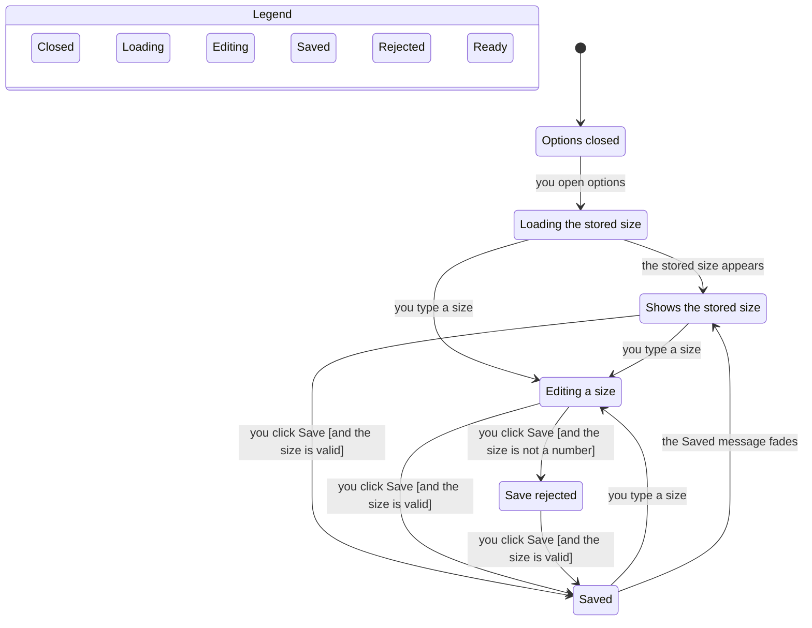
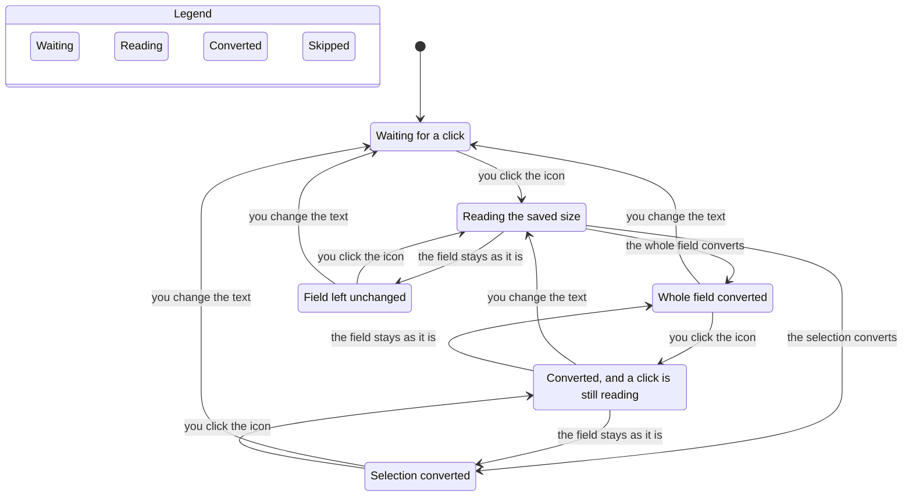
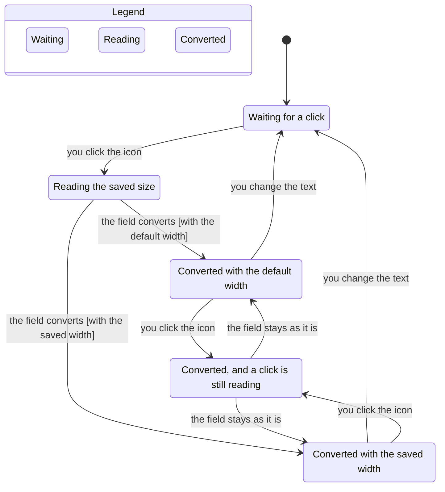
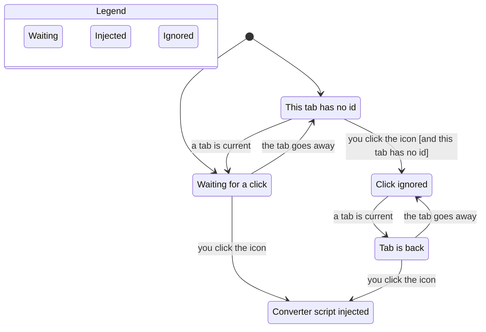
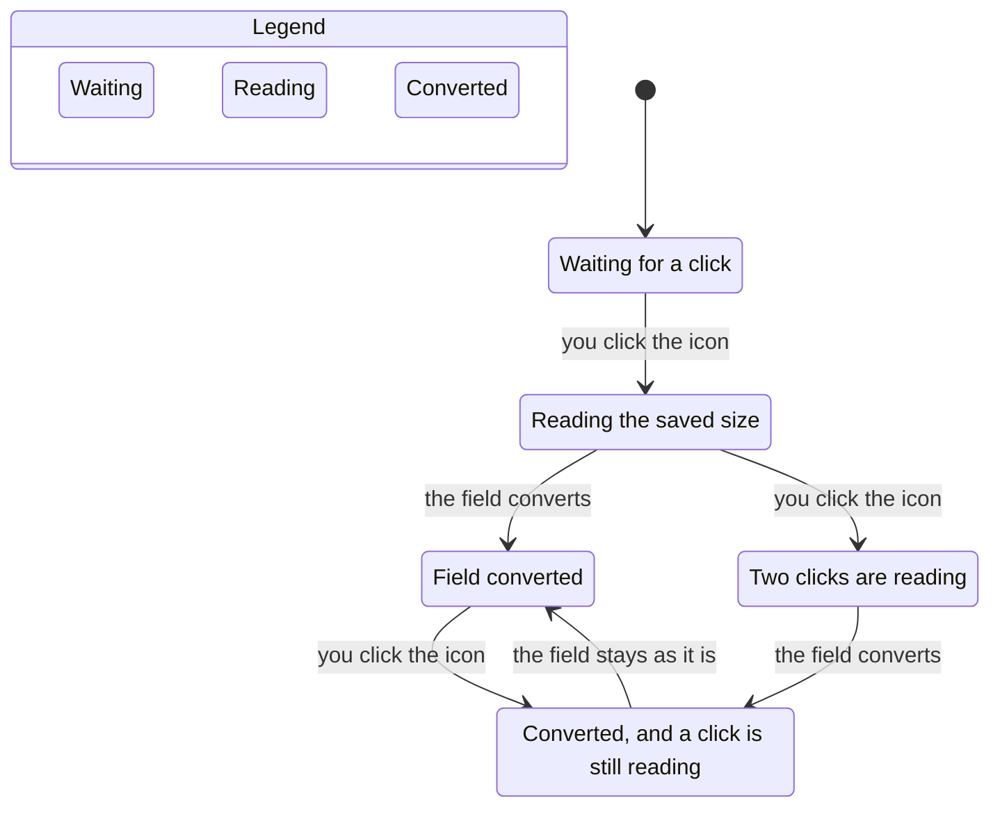

# ImgConverter statecharts

ImgConverter has two screens and one click. The options page loads and saves a width and a height. The toolbar click injects a script into the current tab, and that script reads the saved size and replaces markdown images in one text field. There is no popup, no `chrome.runtime` message, no `chrome.contextMenus` handler, and no download API. The right-click **Options** item is the browser's own menu for `options_ui`. It opens the options page below.

The charts are the state diagrams TLC produced from the models in `spec/tla`. Each rule listed under a chart held, including TLC's deadlock check: every state has a step out of it. The raw TLC log is in `spec/tla/results/<name>/tlc.out`. TLC 2.19 from tla2tools 1.7.4 was the checker.

| Model | What it is | Distinct states | Chart |
| --- | --- | --- | --- |
| `OptionsForm` | Options load, edit, save, and the Saved timer | 197 | 6 states, 10 arrows |
| `ToolbarClick` | One click: which field, which text, caret or selection | 144 | 6 states, 13 arrows |
| `SizeFreeze` | Which saved size that click writes | 60 | 5 states, 9 arrows |
| `ClickWithoutTab` | `background.ts` when `tab.id` is missing | 6 | 5 states, 7 arrows |
| `SecondClick` | A second click before the first callback runs | 6 | 5 states, 6 arrows |

## Options page

`src/js/options.ts` calls `loadStorage` as the page starts. `chrome.storage.sync.get` answers later. Until then the fields are empty. An `input` event on either field marks a draft. **Save** writes only when `decideSave` accepts the text, and only when the user has typed or the load has finished. A successful save bumps a counter so the in-flight load cannot paint over it. Two seconds later the "Saved" message clears. Typing does not clear it. A rejected save replaces it.

The model treats the pair of fields as one value: `empty` (both blank), `set` (a canonical size), or `bad` (rejected). Which field is bad does not change these steps. `spec/js/options.test.js` covers the fields separately.



Rules that hold:

- **ShownSave.** After Save, the fields keep that size until you type again.
- **DraftHeld.** The load does not replace a size you have typed.
- **SaveWaitsForTheLoad.** Save does not store the blank fields while the first load is still in flight.
- **StorageChangesOnlyFromASave.** Storage changes only when Save writes.
- **SavedSizesAreCanonical.** A save never stores a rejected size. A `bad` value can only be there already, from before this page saved.
- **SavedMeansCommitted.** The Saved message means a write happened.
- **RejectionKeepsTheDraft.** A rejected Save leaves the typed text on the form.
- **SettledFormMatchesStorage.** When the form is idle and you are not editing, the fields show the canonical stored size. A stored `bad` value is shown as empty.
- **NoDeadlock.** Every state has a step out of it.

The chart hides the Save click that happens while the form is still loading and you have not typed. The screen does not change, and storage is not written. It also hides typing that stays inside "Editing a size", and the load reply that arrives after Save, because the screen stays on Saved.

## Toolbar click

`src/js/background.ts` returns when `tab.id` is missing. Otherwise it injects `src/js/convert-to-img-tag.js` and does not wait. The script remembers `document.activeElement`, then calls `chrome.storage.sync.get`. The callback reads that element's value and selection together. A caret converts the whole value. A range converts the selection. `insertText` runs only when the value contains a markdown image or a GitHub upload tag.



**NeverSkipTheCapturedPicture.** The callback does not skip a picture on the element that was focused when the script started, even if focus has moved. **NoDeadlock** holds.

The chart hides moving focus, moving the selection, and the browser finishing the storage read. Those steps stay on "Reading the saved size" or on the converted field. The next arrow is the one that says whether the field converts.

### Which size is written

`SizeFreeze.tla` is the same callback's size. The callback uses the object `chrome.storage.sync.get` passed it. That object is copied when the browser finishes the get. A save that lands before that copy is visible. A save that lands after it is not. `default` is an empty stored pair, which becomes `width="50%"`. `width` stands for every other canonical pair. Height alone and both sides take the same steps. The pure tests name the attributes.



**FrozenSize.** While the converted tag is what the field shows, its size is the size frozen for that read. **NoDeadlock** holds.

The chart hides saving a new size and the browser finishing the read. Saving does not change the field. The convert arrow names the size that was frozen.

### No tab id



**InjectedOnlyWithATab.** `executeScript` runs only for a click that saw a tab id. Hiding the tab afterwards does not undo that injection, so the chart hides "the tab goes away" while the label stays "Converter script injected". **NoDeadlock** holds.

### Two clicks

Callbacks run one at a time, in the order the gets were issued. The first callback that finds a picture replaces it. The next callback reads the replaced value and does not write. At most two reads are in flight. `spec/browser/reinjection.spec.js` checks that a second injection does not throw.



**SingleConversion.** The field is the original picture or one conversion of it. **NoDeadlock** holds.

## Bugs the models caught

These were in the code. Each one was run against the scripts before the fix, and the same path breaks the model of that old behavior. The models in `spec/tla` describe the code after the fix, and TLC finds no broken rule.

**A late load paints over a save.** You open options while storage is empty. You type a size and click Save. Storage holds the new size and the form says Saved. The load that started when the page opened then returns and writes the old empty snapshot into the fields. The form still says Saved. That breaks ShownSave: after Save, the fields should keep the saved size until you type. The same callback also replaces a draft you have not saved, which breaks DraftHeld. `spec/js/options.test.js` ("does not paint an older size over a save", "does not replace a draft when the load returns") is the run against `options.js`. The fix ignores a load that was issued before the save, and ignores a load while a draft is on the form.

**Save before the load stores a blank pair.** Storage holds `200px`. You open options and click Save before the load returns, without typing. The fields are still the empty page. The old code wrote `{ width: "", height: "" }`. When the load returned, the fields showed `200px` again, but storage was already empty, so the next conversion used `width="50%"`. That breaks SaveWaitsForTheLoad. The test "does not clear storage when Save is clicked before the load returns" is the run. The fix returns before `storage.set` in that case. Clearing both fields after the load has arrived, then clicking Save, still stores the empty pair. That is how the form returns to the default width.

**The click followed whichever field was focused when storage returned.** The field you were editing contained a markdown image. You clicked the icon. Before the storage callback, focus moved to another field. The old code read `document.activeElement` inside the callback, converted the new field, and left the original alone. That breaks NeverSkipTheCapturedPicture. `spec/js/convert-target.test.js` ("converts the element that was focused when the script started") is the run. The fix remembers the element before `storage.get`. The callback still reads that element's current value and selection together, so an edit made during the wait is what gets converted.

## Left out

The picture-matching rules live in `src/pure/convert.ts`. They are not these state machines. `.cursor/skills/verify-convert-replacement` checks them on a bounded set of strings. `spec/pure/policy.test.ts` checks `createParams` when a stored side is not a canonical size. The options model shows that side as empty and will not save it. The toolbar model does not include a legacy bad string already in storage.

`insertText` can return false. The script ignores that return, so a failed write leaves the field unchanged and shows no message. `executeScript` is not awaited, so a rejected injection is also silent. Neither failure is a state in these models. A field inside an iframe, and a contenteditable element with no string `value`, are not converted. The Saved timer is only "the message can clear", not a clock of 2000 milliseconds.

## Run TLC again

From `spec/tla`, with [tla2tools.jar 1.7.4](https://github.com/tlaplus/tlaplus/releases/download/v1.7.4/tla2tools.jar) (sha256 `936a262061c914694dfd669a543be24573c45d5aa0ff20a8b96b23d01e050e88`) and Java 11 or later:

```bash
java -XX:+UseParallelGC -cp tla2tools.jar tlc2.TLC -workers 1 -config OptionsForm.cfg OptionsForm.tla
java -XX:+UseParallelGC -cp tla2tools.jar tlc2.TLC -workers 1 -config ToolbarClick.cfg ToolbarClick.tla
java -XX:+UseParallelGC -cp tla2tools.jar tlc2.TLC -workers 1 -config SizeFreeze.cfg SizeFreeze.tla
java -XX:+UseParallelGC -cp tla2tools.jar tlc2.TLC -workers 1 -config ClickWithoutTab.cfg ClickWithoutTab.tla
java -XX:+UseParallelGC -cp tla2tools.jar tlc2.TLC -workers 1 -config SecondClick.cfg SecondClick.tla
```

`Model checking completed. No error has been found.` is a pass. A failing rule names itself and prints the shortest path.

To draw the charts again, run the statechart skill on each spec with its view and a new `--out` directory:

| Spec | View |
| --- | --- |
| `spec/tla/OptionsForm.tla` | `spec/tla/options-view.mjs` |
| `spec/tla/ToolbarClick.tla` | `spec/tla/toolbar-view.mjs` |
| `spec/tla/SizeFreeze.tla` | `spec/tla/size-view.mjs` |
| `spec/tla/ClickWithoutTab.tla` | `spec/tla/notab-view.mjs` |
| `spec/tla/SecondClick.tla` | `spec/tla/second-view.mjs` |

Set `TLA2TOOLS` to the jar and `JAVA` to the Java binary. The skill installs TLC on its own when those are unset. One chart:

```bash
TLA2TOOLS=/path/to/tla2tools.jar JAVA=java \
  <statechart skill dir>/scripts/statechart spec/tla/OptionsForm.tla \
  --view spec/tla/options-view.mjs \
  --out /tmp/options-chart
```

`--out` must be a new or empty directory. Repeat for the other four rows. Copy `chart.mmd` and `report.md` out of `--out` if you want to refresh `spec/tla/results`.
